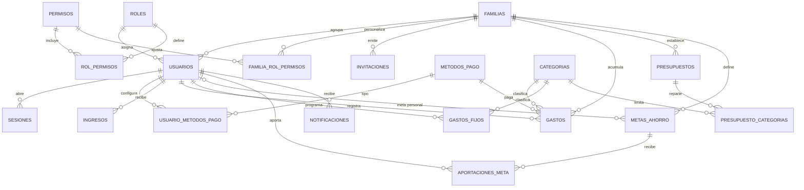
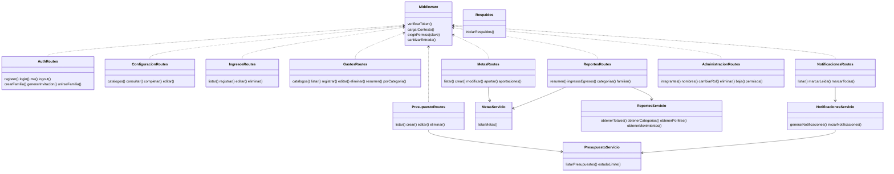

# Diagramas de Famify (RNF28)

## Entidad-relación

Notas:

- `metas_ahorro.usuario_id` nulo indica una meta de toda la familia.
- `ingresos.usuario_id` es texto y se relaciona con `usuarios.id` mediante una conversión.
- `familia_rol_permisos` guarda los cambios de cada familia sobre los permisos por defecto de `rol_permisos`.

## Clases y módulos del servidor

