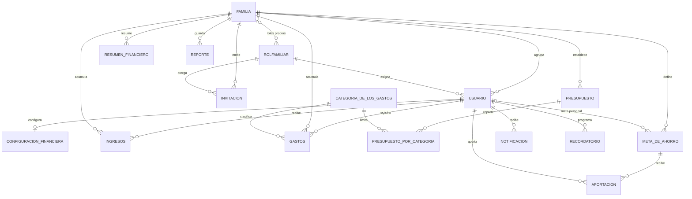

# Diagramas de Famify (RNF28)

## Entidad-relación

Corresponde al script oficial de la base de datos (`famify_db.sql`), que no se modifica.

Notas:

- `meta_de_ahorro.usuario_id` nulo indica una meta de toda la familia; `actual` y `estado` los mantienen triggers a partir de `aportacion`.
- Los permisos de cada rol son una lista separada por comas en `rolfamiliar.permisos`. Los roles base (`familia_id` nulo) no se editan: al cambiar permisos, la familia recibe su propio rol `integrante`.
- Los métodos de pago, la tarjeta de crédito (día de corte y fecha límite) y los gastos fijos viven en `configuracion_financiera`.
- La sesión se controla con `usuario.version_token` y `usuario.ultima_actividad` (`fn_iniciar_sesion`, `fn_validar_sesion`, `fn_cerrar_sesion`).
- Los avisos de corte, pago y gastos fijos los programa `fn_generar_recordatorios`; los de presupuesto y déficit, los triggers de `gastos` e `ingresos`.

## Clases y módulos del servidor

